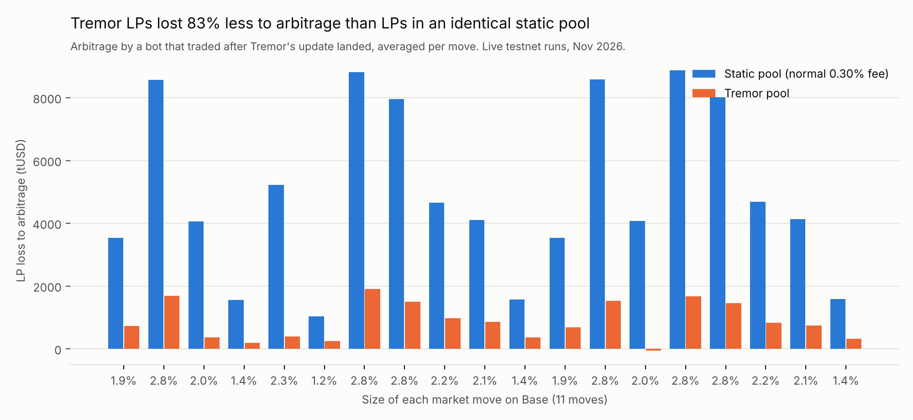

# Tremor

[](https://github.com/Mhiah/Tremor/actions/workflows/test.yml)

**Tremor makes arbitrageurs pay LPs for the gap, using Reactive to bring the real price across chains in about a second.**

Tremor is a cross-chain liquidity protection system for Uniswap v4, built on Reactive Omni for the Reactive Omni Buildathon, Track 1: *Every Second Counts*.

**Live dashboard:** [tremor.myacxt.site](https://tremor.myacxt.site) shows the loop, the experiment results and the pool's current fee, read live from Unichain Sepolia.

> **Status: live on testnet, experiment done.** All four contracts are deployed and the full loop runs on-chain: a price move on Base Sepolia reaches the Tremor pool on Unichain Sepolia through Reactive Lasna in 2 to 3 seconds, with no bot or server. Across 11 live market moves, LPs in the Tremor pool lost about 82% less to arbitrage than LPs in an identical static pool.

---

## The problem

Liquidity providers (LPs) put tokens into a pool so other people can trade. When the market price moves somewhere else first, the pool's price is out of date for a moment. Arbitrage bots trade against that stale price, buying cheap or selling high, until the pool catches up. The bots keep the gap as profit and the LPs pay for it.

This loss has a name: **LVR, loss-versus-rebalancing**. It is one of the largest hidden costs of providing liquidity. A normal fixed fee can't tell arbitrage apart from ordinary trading, so it can't charge arbitrage more.

## The idea

If the pool knew the real market price, it could tell which trades are exploiting the gap and charge them for it. That fee would stay with the LPs.

The hard part is getting the real price into the pool fast, from another chain, with no bot or server in the middle. That is what Reactive Omni does.

## How Tremor works

Tremor has three parts, one on each chain:

1. **Base Sepolia: two independent price sources.**
   - a Uniswap v4 pool on Base: every `Swap` event carries the pool's new price;
   - a `PriceSource` feed: a reporter posts the market price and it emits `PriceReported`.
2. **Reactive Lasna: the validation engine.** `TremorReactive` subscribes to both. On each event it:
   - checks the log really came from one of the two sources, in order, with a price inside sane bounds;
   - converts it to the Unichain pool's orientation and units;
   - combines the fresh sources into one reference (their midpoint) and a confidence score: 100% when they match, falling to 0% when they are 1% apart;
   - publishes only when the reference moved at least 5 bps, confidence changed at least 10 points, or 30 seconds have passed, so callbacks aren't wasted on noise;
   - numbers each update and asks Reactive to deliver it to Unichain.
3. **Unichain Sepolia: the receiver and the hook.**
   - `ReferenceStore` accepts updates only from Reactive's official callback proxy and only from Tremor's reactive contract, and keeps the latest one.
   - `TremorHook`, a Uniswap v4 hook, reads that reference on every swap, measures the live gap to the pool price, and sets the fee.

Lasna decides whether a price can be trusted. The hook works out the gap at the exact moment of each trade, so it is never out of date.

## Tremor as a Reactive loop

Reactive describes what a reactive contract adds to ordinary smart contracts as a loop: **observe, remember, evaluate, react, repeat**. `TremorReactive` on Lasna runs that loop for a Uniswap v4 pool on another chain.

| Step | What Tremor does | Where |
| --- | --- | --- |
| **Observe** | Subscribes to two independent price sources on Base Sepolia: a v4 pool's `Swap` events and a feed's `PriceReported` events. Nothing polls; the events come to the contract. | Reactive Lasna |
| **Remember** | Keeps reaction state on-chain between events: each source's last price, when it was seen and its last log position, plus the last reference it published and an update counter. | Reactive Lasna |
| **Evaluate** | Checks that each event is in order and in range, whether both sources are fresh, how closely they agree (its confidence score), and whether the reference has moved enough to be worth a callback. | Reactive Lasna |
| **React** | Sends a numbered, authenticated callback to the Unichain ReferenceStore. The hook then prices every swap from that reference, on the destination chain. | Reactive Lasna → Unichain Sepolia |
| **Repeat** | Runs on every new event, for as long as the contract holds REACT, with nobody watching. | All three chains |

**Why this matters for Tremor**

- **No keeper or bot in the middle.** Without Reactive, carrying Base's price to a Unichain pool needs an off-chain watcher someone has to run and trust. Here the whole path is contracts reacting to contracts.
- **Rules enforced by code.** The surcharge is capped, falls to zero when the sources disagree, and expires when the reference ages. The live manipulation test shows these rules holding under attack.
- **A record anyone can check.** Every step leaves a transaction on its chain: the Base event, the Lasna reaction and the Unichain callback. The source code is verified, so anyone can read why the contract acted, not just that it did.
- **Uniswap hooks and Reactive callbacks together.** The hook decides each trade's fee on Unichain; the reactive contract decides what that hook should believe about the market on Base.

## The fee rule

Every swap pays the pool's normal fee, except trades that **move the pool toward the reference price**. Those trades are the ones taking value from LPs, so they pay a surcharge:

```
fee = min(maxFee, baseFee + beta × confidence × max(gap − baseFee − margin, 0))
```

| Setting | Meaning | Starting value |
| --- | --- | --- |
| `baseFee` | Normal pool fee | 30 bps |
| `gap` | Live gap between pool price and reference | measured on each swap |
| `confidence` | Trust in the reference, 0 to 100%, fading with age | from Lasna |
| `beta` | Share of the gap to capture | 70% |
| `margin` | Left to the arbitrageur for gas and price discovery | 10 bps |
| `maxFee` | Fee ceiling | 500 bps |

**Example.** With a 200 bps gap and 90% confidence, an arbitrage trade pays 30 + 0.7 × 0.9 × 160 = **130.8 bps**. A normal trade pays 30 bps. The arbitrageur still keeps about 69 bps, so it still corrects the pool.

**Why not charge the whole gap?** Then nobody would arbitrage and the pool would stay at the wrong price. Tremor takes most of the gap for LPs and leaves enough for arbitrage to happen. A fuzz test checks that the fee is always below the gap.

**When Tremor charges only the normal fee:**

- no reference has arrived yet;
- the reference is older than the maximum age;
- confidence is below the minimum (the two sources disagree, or the update is getting old);
- the trade moves the pool away from the reference;
- the gap is smaller than the normal fee plus the margin.

## Four modes, one hook

To measure what each part adds, the same hook can run a pool in four modes:

| Mode | Behaviour |
| --- | --- |
| `STATIC` (A) | Always the normal fee. The control pool. |
| `GAP` (B) | Surcharge on any trade when there's a gap. No direction check, no confidence. |
| `DIRECTIONAL` (C) | Surcharge only on trades toward the reference. No confidence. |
| `FULL` (D) | Full Tremor: direction, confidence and freshness. |

Every swap emits a `FeeQuoted` event with the gap, confidence, fee and the reason, so the experiment can measure exactly what each trade paid and why.

## Safety

| Threat | Protection |
| --- | --- |
| Fake price update | `ReferenceStore` accepts only Reactive's callback proxy and Tremor's reactive contract |
| Replayed old update | Sequence number must always increase |
| Late update | Maximum age; older references pay the normal fee |
| Bad values | Zero prices, confidence over 100% and future timestamps are rejected |
| Fee abuse | Fee ceiling of 10% in the hook, bounded settings, checked maths |
| One source manipulated | The other source disagrees, confidence drops to 0 and the hook charges only the normal fee |
| Out-of-order or duplicate logs | `TremorReactive` ignores any log older than the last one it accepted from that source |
| Wasted callbacks | Small moves are filtered out on Lasna before a callback is paid for |
| Wrong pool type | The hook refuses pools without dynamic fees, and pools it hasn't been configured for |

## Results: the live experiment

Tremor was tested live on testnet against an identical pool without it. Every market move was tested against seven pairs of pools at once; each pair holds one **static** pool (normal 0.30% fee) and one **Tremor** pool, the same in every other way. For each pair, an arbitrage bot traded both pools toward the new market price after a set reaction time.

**LP loss** is what the arbitrage bot made, valued at the market price. That is exactly what the pool's LPs lost compared with a pool that always had the right price.



| What we measured | Result |
| --- | --- |
| Full loop, Base event to Unichain callback | **2 to 3 s** (median 3 s over 11 moves, from block timestamps) |
| LP loss, bots that traded with Tremor's update in place | **about 82% lower** in the Tremor pool than in the static pool |
| LP loss, every bot trade (77 trades) | **97% lower** in the Tremor pool |
| Bots that planned their trade on the old fee | lost money in the Tremor pool, so its LPs came out ahead |
| Ordinary trades away from the reference | normal 0.30% fee, every time |

**What the numbers mean**

- **Rational arbitrage after the update lands.** The bot reads the fee before trading and stops where trading stops paying. Tremor's surcharge takes most of the gap, so LPs keep most of what they would have lost. The pool still gets corrected, because the bot still trades.
- **Bots that raced the update.** Some bots read the old fee, then their trade landed after Tremor's update. They paid the surcharge on a trade sized for the normal fee, and lost money. That is why the all-trades figure is above the rational-bot figure.
- **Speed.** Reactive's loop landed every update in 2 to 3 seconds. The experiment's bots quoted, estimated and sent over public RPC endpoints, so they needed 6 to 12 seconds to land a trade and always arrived after the update. A faster bot does beat it: see the fast-bot test below.

**Honest limits**

- The market, the price feed and the arbitrage bots are our own scripts on testnet. Real markets move without warning and real arbitrageurs are faster.
- An arbitrageur that lands its trade in the 2 to 3 seconds before Tremor's update pays only the normal fee. Tremor does not stop that, and the fast-bot test below shows it happening live. The faster Reactive's loop, the smaller that window.
- 11 market moves is a small sample, limited by testnet funds. The runner is in the repo, so anyone can run more.

The raw data is in `experiment/results/` (`run-a`: bot clock starts when the Base trade is confirmed; `run-b`: bot clock starts when the market moves). Every row links to its transactions.

### What each part adds: four modes, live

The same hook can run a pool in four modes. Four Unichain pools, identical except for the mode, faced the same 3 market moves (-1.8%, +2.9%, -2.8%) and then a manipulated feed (pushed 5% above the market while the Base pool stayed put):

| Mode | LP loss to arbitrage, 3 moves | Fee on arbitrage | Fee on an ordinary trade | Manipulated feed: fee toward the fake price | Manipulated feed: fee the other way |
| --- | --- | --- | --- | --- | --- |
| A: Static (control) | 20,716 tUSD | 30 bps | 30 bps | 30 bps | 30 bps |
| B: Gap fee, no direction | 2,186 tUSD (89% less) | 178 bps | 178 bps | 178 bps | 178 bps |
| C: Direction-aware, trusts any price | 2,186 tUSD (89% less) | 178 bps | 30 bps | 178 bps | 30 bps |
| D: Full Tremor | 4,124 tUSD (80% less) | 164 bps | 30 bps | 30 bps | 30 bps |

Fees in the move columns are averages over the 3 moves, quoted after Tremor's update landed.

- **B (gap fee)** protects LPs well but charges every trader the surcharge, including ordinary traders who aren't taking anything from LPs. Under manipulation it charges everyone 1.78% on a price that isn't real.
- **C (direction only)** spares ordinary traders but trusts whatever price arrives. Under manipulation, trades toward the fake price pay 1.78%.
- **D (full Tremor)** spares ordinary traders and refuses to charge on a price its sources disagree about. It keeps a little less than C because confidence fades as the update ages, which is the price of that safety.

Full record: `experiment/results/modes.json`.

### Live fast-bot test: the window Tremor can't close

This bot prepares and signs its Unichain trades before the market moves, then sends them at the same instant as the Base trade, as an arbitrageur watching another venue would. Over 3 market moves:

| Market move | Tremor's update landed | Bot's trade landed | Tremor fee paid | Bot's Tremor-pool trade |
| --- | --- | --- | --- | --- |
| +2.07% | 2 s | same second as the Base trade | 30 bps | `0x9547a666d2904138bffc6db5756b64c6ef8a884677cf9b1d8103d57d0f76f992` |
| -1.75% | 2 s | same second as the Base trade | 30 bps | `0xcbad4f25b0969847799a3c7d914040b04c47d8d61e0cac1ffeff2b6008762c3d` |
| -2.37% | 2 s | same second as the Base trade | 30 bps | `0x22744b7f61ed342c1f9dcc47cedd5f349addaaa36cecfce925c9a0adc13369c6` |

Every time, the bot's trade landed before Tremor's update and paid the normal 0.30%, so the Tremor pool lost exactly as much as the static pool. That is the honest edge of the design: Tremor charges arbitrage that arrives after the update, and the 2-second loop is the window it leaves open. Full record: `experiment/results/fastbot.json`.

### Live manipulation test

What if someone controls one price source and pushes it away from the market? Tremor should refuse to charge on a price it can't trust.

The test pushed the price feed 5% above the market while the Base pool stayed at the real price. Lasna saw the two sources 5% apart, published the reference with **0% confidence**, and a trade toward the fake price in the Tremor pool paid the **normal 0.30%**, not the 1.78% it would have paid had the fake price been trusted.

| Step | Network | Transaction |
| --- | --- | --- |
| Base pool trades at the real price (2,986) | Base Sepolia | `0x2255b2dd385a8692e814e495170135f60696e35e37237d1ec2cfb24d054aabd3` |
| Feed pushed to a fake 3,136 | Base Sepolia | `0x402de3288cc33fe63f89fbe0ec9cad9679641b321a3e00408921bb26066e6e22` |
| Lasna: sources 5% apart, 0% confidence | Reactive Lasna | `0x5c80bfbddafe7bc74dfc316a6c0f34dcb301c8d63328f48909017365b14ca0d9` |
| Reference lands on Unichain at 0% | Unichain Sepolia | `0x43778af609bac92f3dc0eb8278ad9654786ad04422174738d1ea92989883fa47` |
| Trade toward the fake price pays 0.30% (reason: low confidence) | Unichain Sepolia | `0xce49b20d942a749a102deb545b3381584f65b71a3b44d45fbfc34564750a0082` |

The trade-off: an attacker who can move one source can switch the surcharge off, but never on. The worst case is a pool that behaves like an ordinary Uniswap pool. Full record: `experiment/results/manipulation.json`.

### Run the experiment yourself

```bash
pip install web3 matplotlib
set -a; source .env; set +a   # PRIVATE_KEY plus the addresses printed by the deploy scripts
python3 experiment/run.py --delays 0,0.5,1,1.5,2,3,5 --moves 5
python3 experiment/chart.py
python3 experiment/manipulation.py   # the live manipulation test
python3 experiment/fastbot.py        # the live fast-bot test
python3 experiment/modes.py          # the four-mode comparison
```

## Repository layout

```
src/
  base/PriceSource.sol        Reported price feed (Base Sepolia)
  reactive/TremorReactive.sol Validation engine (Reactive Lasna)
  ReferenceStore.sol          Reactive callback receiver (Unichain Sepolia)
  TremorHook.sol              Uniswap v4 hook (Unichain Sepolia)
  interfaces/IReferenceSource.sol
  libraries/TremorFeeMath.sol The fee maths, kept separate so it can be tested on its own
script/                       Deploy scripts for all three chains, plus the extra experiment pools
experiment/
  run.py                      Live experiment runner
  manipulation.py             Live manipulation test
  fastbot.py                  Live fast-bot test (pre-signed trades)
  modes.py                    Live four-mode comparison
  chart.py                    Draws the results chart
  results/                    Raw data from each run
test/
  TremorHook.t.sol            Hook tests against the real v4 PoolManager, including real swaps
  TremorFeeMath.t.sol         Fee maths, including a fuzz test that arbitrage always keeps a share
  TremorReactive.t.sol        Source matching, agreement, filtering, manipulation, and the callback
                              landing in the ReferenceStore end to end
  ReferenceStore.t.sol        Callback authentication, replay and validation tests
  PriceSource.t.sol           Reporter permissions and event shape
```

## Run it

Requires [Foundry](https://book.getfoundry.sh/).

To deploy your own copy, set `PRIVATE_KEY` and run, in order: `script/DeployBase.s.sol` (Base Sepolia), `script/DeployReactive.s.sol` (Lasna), `script/DeployUnichain.s.sol` (Unichain Sepolia), then `script/ConfigureReactive.s.sol` (Lasna). Each script lists the environment values it needs from the one before.

```bash
git clone --recurse-submodules https://github.com/Mhiah/Tremor
cd Tremor
forge build
forge test
```

Current result: **49 tests passing**.

## Networks

| Role | Network | Chain ID |
| --- | --- | --- |
| Price sources (v4 pool + PriceSource) | Base Sepolia | 84532 |
| Validation engine | Reactive Lasna | 5318007 |
| Hook and receiver | Unichain Sepolia | 1301 |

## Live deployment (testnet)

| Contract | Network | Address |
| --- | --- | --- |
| tETH / tUSD test tokens | Base Sepolia | `0x64419165D8e0e6fC7Edb69cB1c9061FF55dfa738` / `0xC4bf9ca099A4537E82b8b8aaDEBE69053C0b6181` |
| tETH/tUSD v4 pool (source 1) | Base Sepolia | PoolManager `0x05E73354cFDd6745C338b50BcFDfA3Aa6fA03408`, pool ID `0xded3b395…ad5b4` |
| PriceSource feed (source 2) | Base Sepolia | `0x813737EC15992C390E9C6471851B3c92FcCB4758` |
| TremorReactive | Reactive Lasna | `0x42338a1E7607CC56d19Adc97cD92dd9F9C5Dd512` |
| ReferenceStore | Unichain Sepolia | `0x508f12C53d3e57473291c544Df070A5e8B0464C5` |
| TremorHook | Unichain Sepolia | `0x6c19C2F3F2F8e976b6799d40c5049EcFEb22a080` |
| tETH / tUSD test tokens | Unichain Sepolia | `0x42338a1E7607CC56d19Adc97cD92dd9F9C5Dd512` / `0x64419165D8e0e6fC7Edb69cB1c9061FF55dfa738` |
| Static pool (mode A, control) | Unichain Sepolia | pool ID `0xf3709172…0836b` |
| Tremor pool (mode D) | Unichain Sepolia | pool ID `0x6e2eeb6d…0d178` |

The test tokens can be minted by anyone; they exist only to make a repeatable experiment.

**Verified source.** TremorReactive, ReferenceStore, TremorHook and PriceSource are verified on [Sourcify](https://sourcify.dev) with an exact match (creation and runtime bytecode), so their source is readable on Reactscan, Uniscan and Basescan.

### First full loop, on-chain

The market moved from 3,000 to 3,060 tUSD per tETH (+2%) on Base. Each update crossed three chains with no bot or server involved:

| Step | Base Sepolia (origin) | Reactive Lasna (validation) | Unichain Sepolia (callback) | Base event → Unichain |
| --- | --- | --- | --- | --- |
| Pool swap moves price to 3,060 | `0xb2a1ada23158938a91b3c99422455ab77edef10853ebf006d49b1e96547396fb` | `0xdcc2123f9c78309987ac89404d33261b7d4bada0c7a6564acd10fc3920ee37e7` (one source, 50% confidence) | `0x2350493ecca5a41df54108beb20fcddb5590449f883e1158cc39bb0fa848b769` | 3 s |
| Feed confirms 3,060 | `0xb0c5ae10222abba30c5413b7d1b79d37bee8e4f303446eb2fc000353c3659379` | `0xf3c610ee91abc73e6c8f5d65dd48c5f671710fdc1cc6fa87ff8ba08cfb517bbe` (sources agree, 100% confidence) | `0xff01afad8cc7a572d76bc69afd01f75e1817cb14a08b477da2fe1cad69e0abf4` | 3 s |

Latency here is measured from on-chain block timestamps, which have one-second resolution. The experiment will report medians over many runs.

### First live arbitrage, same trade into both pools

With the Unichain pools still at 3,000 and the reference at 3,060, the same 1,000 tUSD purchase of tETH went into each pool:

| Pool | Fee charged | tETH received | Transaction |
| --- | --- | --- | --- |
| Static (mode A) | 30 bps | 0.33233 | `0x9d7f0400290e3be4dfb4a64c6aa432de8fde9d7bce2713ee5acde38fd31cc063` |
| Tremor (mode D) | 86 bps | 0.33046 | `0x63309a5ac93ae5247769c62b3a52020c4ee051663202266b93182537cf1bc4c6` |

The arbitrage trade paid 56 bps more in the Tremor pool, and that difference stayed with the LPs. The surcharge was below the full rule's 118 bps because confidence had faded with the reference's age by the time of the trade, exactly as designed. An ordinary trade in the other direction was quoted the normal 30 bps.

## Built with

- [Uniswap v4](https://developers.uniswap.org/docs/protocols/v4/deployments) (hooks, dynamic fees)
- [Reactive Omni](https://dev.reactive.network/) (`reactive-lib-omni`)
- [Foundry](https://book.getfoundry.sh/)

## License

MIT
